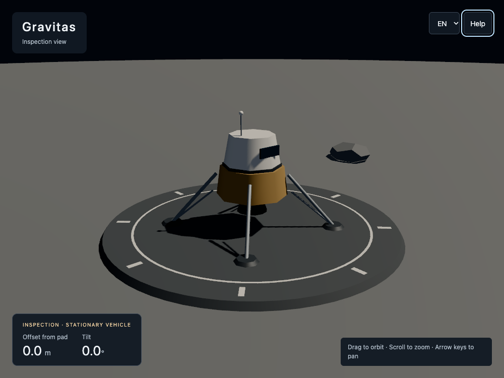
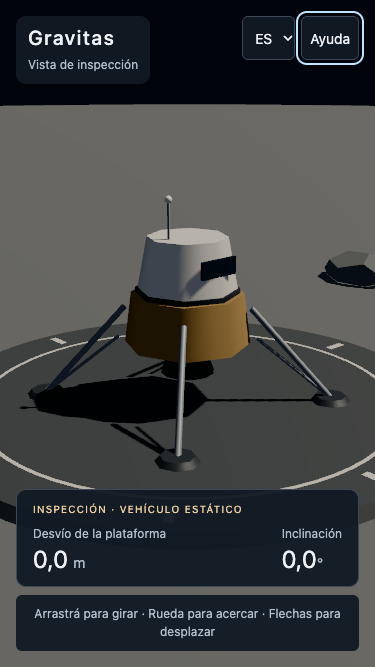

# Bilingual inspection UI verification

Step 0.4 was verified locally on 2026-11-06. Owner visual review and deployment
of this step follow PR review/merge. CI remains limited to fast checks/build.

## Environment and results

- MacBook Pro (`MacBookPro18,1`), Apple M1 Pro, 32 GiB RAM, macOS 15.7.9.
- Node 24; pinned Playwright 1.64.1 and Chromium 156.0.8078.4.
- `npm run check`: format, lint, types, and eight unit tests passed.
- `npm run test:e2e`: all 13 tests passed on forced WebGL 2.
- `npm run test:e2e:webgpu`: all 13 tests passed, including actual WebGPU/backend
  and rendered-content assertions. Explicit fallback/context-loss cases still
  exercise WebGL as designed.
- After refining focus during translation loading and language changes after
  graphics failure, reran the six affected tests on each backend; all passed:
  `npm run test:e2e -- --grep 'locale|keyboard|language|translation|production context loss'`
  and the equivalent `test:e2e:webgpu` command.
- Both browser scripts built production assets successfully. The existing Vite
  advisory for the renderer chunk over 500 kB remains.
- Manual in-app browser review confirmed the desktop scene, language switching,
  readable help dialog, and focus placement. Screenshots below cover desktop and
  narrow layouts from the final WebGPU checks.

## What is covered

- Spanish and English UI, numeric decimal formatting, document language, URL,
  loading/failure copy, and canvas accessibility labels.
- The same canvas and nonzero pose readouts survive locale changes. A screenshot
  of the unobscured scene remains identical after moving the camera and switching
  languages, checking that camera state is preserved.
- A delayed translation request retains selector focus; a failed download leaves
  the previous language and rendered scene usable with a reload hint.
- Locale changes work during renderer loading and after a lost graphics context.
- Tab navigation reaches the canvas, language selector, and help. Native modal
  help contains focus, closes with Escape, and restores focus to its opener.
- At 375 × 667, both locales have visible readouts, in-bounds overlays, no horizontal
  overflow, and a fitting dialog. Reduced-motion preference is exercised; the UI
  adds no animation.
- Measurement references: a 3–4–5 horizontal offset ignores height; upright/yaw,
  90-degree tilt, and inverted orientations have independently known angles.
- Existing viewport lifecycle, pose validation, backend fallback, and resource
  cleanup checks remain intact.

These are local desktop-device checks with a narrow viewport, not physical phone
or touch-flight validation. The scene remains static; no flight physics, fuel,
contact thresholds, or mission outcomes are claimed.

## Visual review

Desktop English (1000 × 750):

Narrow Spanish (375 × 667):

## Try it

Run `npm run dev`. Move the camera, switch ES/EN, and confirm it stays in place.
Tab through the scene and controls; open Help/Ayuda, press Escape, and check focus
returns. Resize to a narrow viewport and inspect both languages. Use
`?backend=webgl2` to request the fallback backend explicitly.
